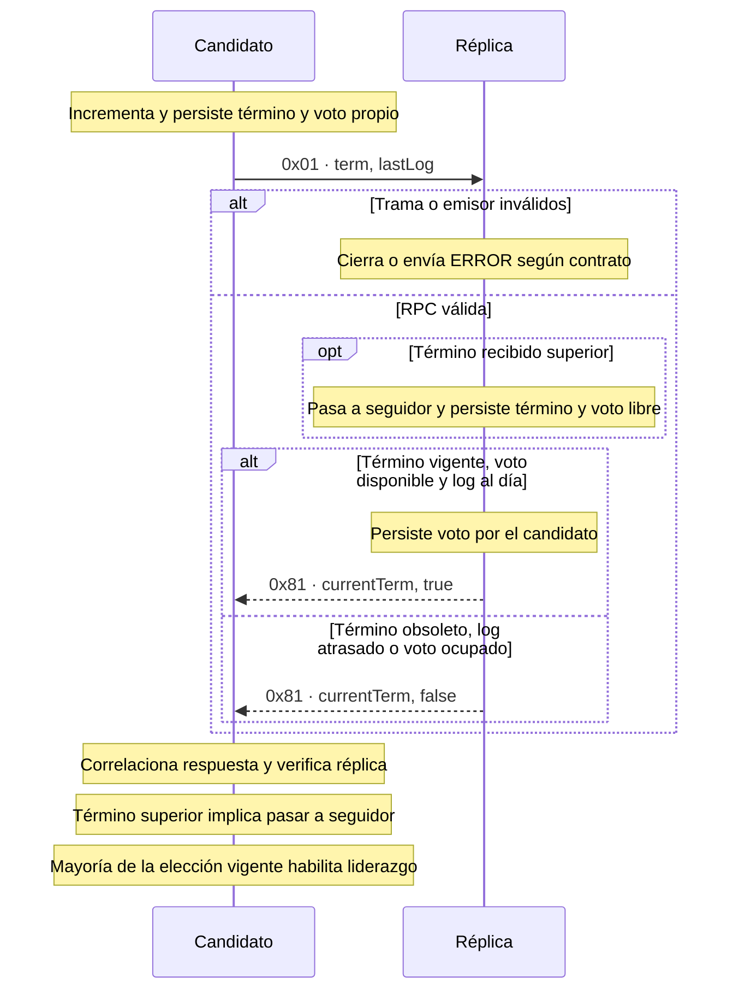
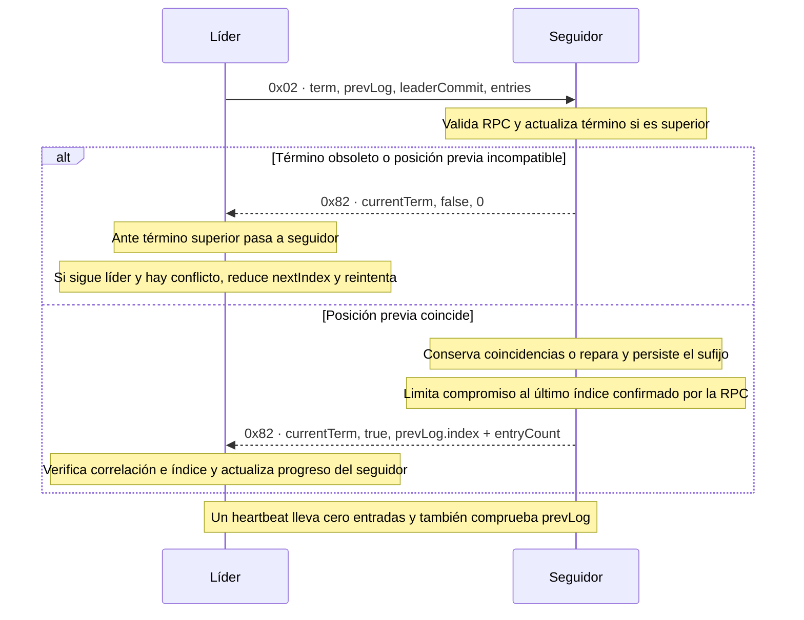

# DM2 · Secuencias Raft

Cada intento abre su propia conexión TCP. La réplica devuelve el mismo `requestId`.
Las secuencias describen el comportamiento previsto por el [contrato](CONTRATO_TCP_v2.md).

## RequestVote

## AppendEntries

